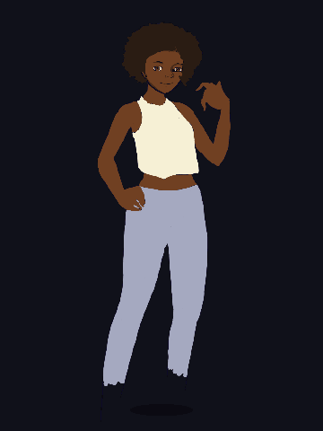
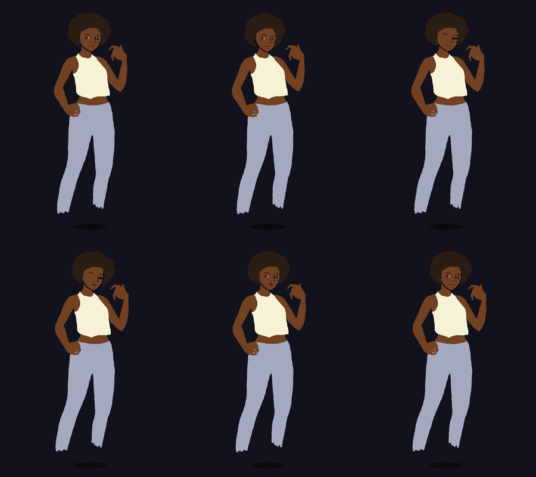

# Cubicraft

<p align="center">
  
</p>

<h3 align="center">A clean-room Live2D-style animation engine in pure Rust</h3>

<p align="center">
  <a href="https://eren-coder07.github.io/cubicraft/"><b>Live Web Demo</b></a> ·
  <a href="https://github.com/eren-coder07/cubicraft/releases"><b>Downloads (APK + EXE)</b></a>
</p>

Cubicraft takes a **real, layered, CC0-licensed anime PSD file**, auto-rigs it into a deformable
part tree, and animates it — breathing, blinking, eye-tracking, hair physics, drag interaction —
entirely on the CPU with **zero rendering dependencies**. One core crate, three platforms:
WebAssembly, Windows, Android.

Built following the [craft-anything](https://github.com/storytold/craft-anything) methodology:
**Study → Build → Check → Ready**.

---

## Downloads

| Platform | File | Notes |
|---|---|---|
| Android | [`cubicraft.apk`](../../releases/latest) | NativeActivity, portrait, no permissions |
| Windows | [`cubicraft-windows.zip`](../../releases/latest) | Standalone exe, model embedded |
| Web | [eren-coder07.github.io/cubicraft](https://eren-coder07.github.io/cubicraft/) | 197 KB wasm + CC0 model |

## Screens

<p align="center">
  
</p>

All six frames are rendered by the engine itself (`cubicraft-desktop --screenshots`).

## How it works

```
Set1.psd (CC0, layered Photoshop)
   │  pure-Rust PSD parser (header → layer records → RLE channel decode)
   ▼
Texture parts ──── rig.json (parts, pivots, cut-out rects, deformer bindings)
   │                 ├─ body   = Body2 ∘ Layer 4(multiply) ∘ clothes ∘ skin
   │                 ├─ face   = Head ∘ face 3
   │                 ├─ eyes   = rect crops + transparent re-fill (blink = squash + fade + lid line)
   │                 ├─ mouth  = rect crop + procedural open-mouth ellipse
   │                 └─ hair   = hair lines ∘ Layer 12 ∘ hair color (grid-warped by physics)
   ▼
Deformer chain: local morph → head chain (AngleX/Y/Z + parallax depth)
              → body chain (breath, hips pivot) → root drag
   ▼
Spring-damper pendulums (hair sway) ← head swing + drag velocity
   ▼
Software rasterizer (bilinear textured triangles, painter's order)
   ▼
RGBA framebuffer → softbuffer (desktop/APK) or putImageData (web)
```

### The parameter system

Cubism-style parameters, each with min/max/default and clamping:

| Parameter | Range | Drives |
|---|---|---|
| `AngleX/Y/Z` | ±30 | head turn / nod / tilt with per-part parallax |
| `EyeLOpen`, `EyeROpen` | 0–1 | blink (squash + fade + procedural lid) |
| `EyeBallX/Y` | ±1 | pupil offset + micro eye shift |
| `MouthOpenY` | 0–1 | closed-smile crossfade → procedural open mouth |
| `BodyAngleX/Y/Z` | ±10 | breathing + lazy sway around hips |
| `DragX/Y` | px | pointer drag of the whole model |
| `HairSway`, `HairSway2` | px | pendulum outputs, weighted toward hair tips |

### Physics

Two spring-damper pendulums chase the head swing (clean-room re-creation of the
pendulum model Live2D documents in `physics3.json`):

```
acc = (target − angle) · stiffness − vel · damping + input_vel
```

Their angles map onto the hair grid warp: displacement grows toward the hair tips
(smoothstep weighting), so the afro lags and springs back when she turns or is dragged.

## The craft-anything method

| Phase | What was done |
|---|---|
| **Study** | Researched Cubism's public architecture: parameter registry, deformer trees (warp + rotation), art meshes, keyform interpolation, `physics3.json` pendulum spec. No proprietary code or formats were copied — only documented concepts. |
| **Build** | Clean-room implementation in pure Rust: PSD parser, rig spec, deformer chain, physics, rasterizer, PNG encoder — all in `crates/core` with no external deps beyond `serde`. |
| **Check** | `cargo test`: PackBits round-trips, PNG header validation, real-PSD parse assertions, parameter clamping, blink cadence, physics settling + stability, rig spec parse. Plus live browser test of the wasm build. |
| **Ready** | One push produces: GitHub Pages web build (Actions), Windows exe and Android APK attached to the release. |

## Usage

```bash
# interactive window (desktop)
cargo run -p cubicraft-desktop --release

# render the README poses + frames
cargo run -p cubicraft-desktop --release -- --screenshots screens
cargo run -p cubicraft-desktop --release -- --frames frames 96

# web
cargo build --release --target wasm32-unknown-unknown -p cubicraft-web
wasm-bindgen --target web target/wasm32-unknown-unknown/release/cubicraft_web.wasm --out-dir site/pkg
# serve site/ and open index.html
```

Controls: **move** pointer — she looks at it · **drag** — pull her around ·
**Space** — blink · **T** — talk · **Esc** — quit.

## Repository layout

```
crates/core      cubicraft-core: psd, rig, model, physics, anim, render, png (pure Rust)
crates/desktop   winit + softbuffer shell; screenshot/frame modes; Android entry point
crates/web       wasm-bindgen shell (canvas putImageData)
assets/model     Set1.psd — the CC0 anime model (embedded via include_bytes!)
assets/rig.json  rig spec: parts, cut-out rects, pivots, physics tuning
web/index.html   demo page
.github/workflows build.yml — test + Pages deploy + exe + APK release upload
```

## Credits

- Character art: **"Visual Novel Style Characters"** by [MadameBerry](https://opengameart.org/users/madameberry),
  published on [OpenGameArt](https://opengameart.org/content/visual-novel-style-characters) under **CC0**.
- Code: MIT — see [LICENSE](LICENSE). Art remains CC0 (public domain).

> Built with the [craft-anything](https://github.com/storytold/craft-anything) study → build → check → ready method.
